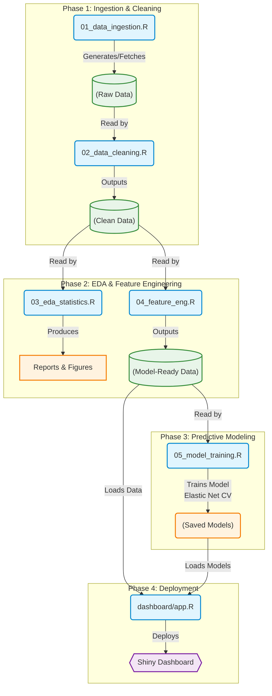

# The Predictive Market Intelligence Suite

**Focus:** Statistical Theory, Predictive Modeling, and Strategic Communication  
**Tech Stack:** R, Shiny, Tidyverse, Tidymodels/Caret  
**Methodology:** CRISP-DM 

## 📌 Project Overview
The Predictive Market Intelligence Suite is an end-to-end R-based analytics project designed to perform a deep-dive analysis of large-scale datasets, specifically focusing on predicting future outcomes in healthcare market trends. 

This project goes beyond basic analysis by rigorously applying established statistical frameworks and prioritizing actionable visual storytelling for non-technical stakeholders. 

---

## 🔄 Project Flow & Methodology

This project is executed in four distinct phases, bridging raw data ingestion with high-fidelity, interactive deployment.

### Phase 1: Methodology & Data Cleaning
* **Lifecycle:** Guided by the **CRISP-DM** framework to ensure business understanding drives the data approach.
* **Execution:** Utilizes principles from *R for Data Science* and strictly adheres to **Tidy Data** standards. Raw market data is ingested, structurally normalized, and cleaned to handle missing values and outliers seamlessly.

### Phase 2: Statistical Foundations & EDA
* **Exploratory Data Analysis (EDA):** Grounded in *Introduction to Statistical Learning (ISL)* and *The Analytics Edge*. 
* **Validation:** Code and logic are continuously validated through an "interactive practice" approach, ensuring robust, error-free pipelines.
* **Communication of Uncertainty:** Applies concepts from *Naked Statistics* to ensure variance, confidence intervals, and statistical significance are translated into plain, understandable business language.

### Phase 3: Predictive Modeling
* **Framework:** Built heavily on techniques outlined in *Applied Predictive Modeling*. Models (e.g., Elastic Net Linear Regression) are trained, cross-validated (rolling-origin), and tuned.
* **Data Handling:** Ensures data leakage prevention, proper train/test splitting, and advanced feature engineering aligned with best practices.

### Phase 4: Visual Storytelling & Deployment
* **High-Fidelity Dashboard:** The final output is an interactive dashboard (built via Shiny) allowing stakeholders to explore predictions dynamically.
* **Visualization Design:** Visualizations are sourced from the R Graph Gallery, but their design is strictly governed by the principles of *Storytelling with Data* to make insights actionable.

---

## 📊 Detailed Workflow Architecture



---

## 📂 Project Directory Structure

```text
predictive-market-intelligence/
│
├── data/
│   ├── raw/                  # Immutable original market datasets
│   ├── processed/            # Cleaned, tidy datasets ready for modeling
│   └── dictionary.md         # Data dictionary detailing variable definitions
│
├── scripts/
│   ├── 01_data_ingestion.R   # Scripts for API pulls or CSV loading
│   ├── 02_data_cleaning.R    # Tidyverse data wrangling pipelines
│   ├── 03_eda_statistics.R   # Statistical summaries and EDA visualizations
│   ├── 04_feature_eng.R      # Feature creation and scaling
│   └── 05_model_training.R   # Tidymodels training scripts & rolling CV
│
├── models/
│   ├── saved_models/         # Serialized model objects (.rds)
│
├── dashboard/
│   ├── app.R                 # Main Shiny application script
│   └── www/                  # CSS, images, and custom assets for styling
│
├── outputs/
│   ├── figures/              # High-res static plots for reports
│   └── reports/              # RMarkdown/Quarto generated analytical reports
│
├── .gitignore                # Files to ignore (e.g., raw data, .Rhistory)
├── Dockerfile                # Docker configuration
├── docker-compose.yml        # Docker compose setup
├── setup.R                   # Environment setup script
├── run.bat                   # Windows batch script to run dashboard
└── Readme.md                 # Project documentation
```

---

## 🚀 Build & Run Instructions

### Prerequisites
- **R (>= 4.0)** installed on your system
- **Docker** installed (optional, for containerized run)

### Local Development (R environment)
1. Open a terminal in the project root.
2. Run the setup script to install required R packages and restore the environment:
   ```bat
   Rscript setup.R
   ```
3. Launch the Shiny dashboard:
   ```bat
   R -e "shiny::runApp('dashboard/')"
   ```
   *The app will be available at `http://localhost:3838`.*

### Docker Container (optional)
1. Build the Docker image:
   ```bash
   docker build -t predictive-suite .
   ```
2. Start the container using Docker Compose:
   ```bash
   docker-compose up
   ```
   *Access the dashboard at `http://localhost:3838`.*

### Windows Shortcut Script
- A `run.bat` script is available in the project root. Double‑click it to automatically run the setup script and launch the Shiny app.

---
*For further customization or deployment, refer to the `Dockerfile` and `docker-compose.yml` configuration.*